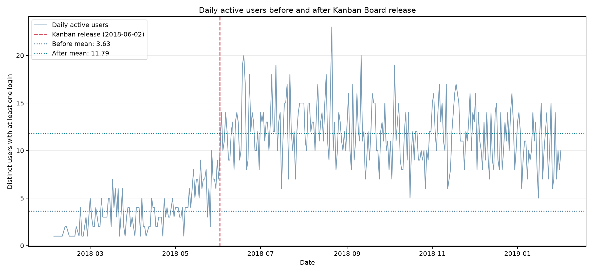
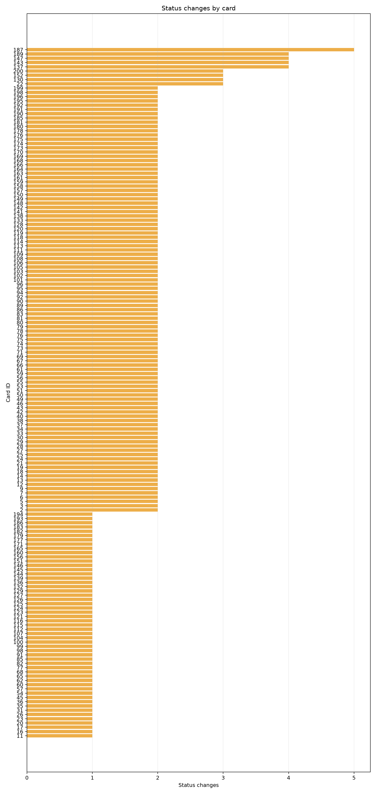

# Shiptivity Kanban Board analysis

## Scope

The Kanban Board released on **2018-06-02**. This analysis measures daily active
users (DAU) from `login_history` before and after that date, then examines card
status transitions in `card_change_history`.

The source database was read only. No table or row was changed.

## Database structure

| Table | Purpose | Rows |
|---|---|---:|
| `user` | User identities | 100 |
| `login_history` | User login events, stored as Unix timestamps | 4,060 |
| `card` | Current card state and priority | 200 |
| `card_change_history` | Card status and priority history | 486 |

`card_change_history` contains 200 initial card insertions with `oldStatus IS
NULL`. The analysis excludes those rows from status-transition counts. It counts
only rows where an existing status changed.

## Daily active users

DAU means distinct `user_id` values with at least one login on a calendar day.
Dates use UTC conversion through SQLite's `unixepoch` modifier.

| Period | Dates | Active days | Mean DAU | Minimum | Maximum |
|---|---|---:|---:|---:|---:|
| Before release | 2018-02-03 to 2018-06-01 | 110 | 3.63 | 1 | 10 |
| After release | 2018-06-02 to 2019-02-01 | 245 | 11.79 | 5 | 23 |

The post-release mean is **8.16 users higher**, or **225.1% above** the
pre-release mean. Unique users with any login rose from 38 before release to 99
after release, out of 100 users in the database.



The chart shows daily observations and period means. The result supports a
strong association between the release date and higher activity. It does not
prove causation: the data has no control group, and other product or seasonal
changes may contribute.

## Status changes by card

There were **286 actual status transitions** across **162 cards**. The most
common transitions were:

| Transition | Count |
|---|---:|
| `backlog` to `in-progress` | 167 |
| `in-progress` to `complete` | 103 |
| `in-progress` to `backlog` | 11 |
| `complete` to `in-progress` | 5 |

Card 187 changed status five times. Cards 137, 143, 147, and 189 changed four
times each. The chart includes all 162 cards with at least one real status
transition.



The dominant forward path is `backlog` to `in-progress` to `complete`
(270 transitions, 94.4% of all transitions). Reverse transitions total 16
(5.6%), which suggests most tracked work moves forward, while a smaller set
needs rework or reprioritization.

## Data-driven engagement features

### 1. Daily board digest

**Hypothesis:** A daily summary of cards moved into `in-progress` or `complete`
will give users a reason to return and maintain momentum.

**Expected impact:** Increase repeat daily logins and DAU. Measure seven-day
return rate, notification click-through rate, and DAU against a randomized
holdout. The baseline to beat is 11.79 mean post-release DAU.

**Feature:** Send an optional morning or evening digest showing each user's
recent card movements, cards blocked in backlog, and one suggested next action.
Deep-link each item to the relevant board card.

### 2. Stalled-card reminders

**Hypothesis:** Cards that remain in `backlog` or `in-progress` without movement
are actionable re-entry points; reminders will turn dormant work into board
visits.

**Expected impact:** Increase return sessions and reduce time between status
changes. Measure reminder open rate, status changes within 24 hours, and
seven-day retention for reminded users versus a holdout.

**Feature:** Detect cards with no status change for a configurable period.
Notify the owner with actions to move the card, change priority, or snooze the
reminder. Start with a low frequency to avoid notification fatigue.

### 3. Rework and collaboration prompts

**Hypothesis:** Reverse transitions (`in-progress` to `backlog` and `complete` to
`in-progress`) signal uncertainty or rework. Structured prompts can create
useful collaboration and bring users back to resolve the issue.

**Expected impact:** Increase productive sessions around reworked cards and
reduce repeated reversals. Measure comments or collaborator actions per
reworked card, time to the next forward transition, and reversal rate.

**Feature:** When a user moves a card backward, offer a reason such as blocked,
scope change, or quality issue. Notify relevant collaborators and show a
checklist or suggested next step. Keep the prompt dismissible.

## Reproducibility

The following SQL queries are used for schema inspection, DAU calculations,
period summaries, card-change counts, and daily change activity:

```sql
-- 1. Database structure and row counts.
SELECT name, type
FROM sqlite_master
WHERE type IN ('table', 'view')
ORDER BY type, name;

SELECT 'user' AS table_name, COUNT(*) AS row_count FROM user
UNION ALL
SELECT 'login_history', COUNT(*) FROM login_history
UNION ALL
SELECT 'card', COUNT(*) FROM card
UNION ALL
SELECT 'card_change_history', COUNT(*) FROM card_change_history;

-- 2. Daily active users, with release-period label.
WITH daily_active_users AS (
    SELECT
        date(login_timestamp, 'unixepoch') AS activity_date,
        COUNT(DISTINCT user_id) AS active_users
    FROM login_history
    GROUP BY activity_date
)
SELECT
    activity_date,
    CASE
        WHEN activity_date < '2018-06-02' THEN 'before'
        ELSE 'after'
    END AS release_period,
    active_users
FROM daily_active_users
ORDER BY activity_date;

-- 3. Mean daily active users before and after release.
WITH daily_active_users AS (
    SELECT
        date(login_timestamp, 'unixepoch') AS activity_date,
        COUNT(DISTINCT user_id) AS active_users
    FROM login_history
    GROUP BY activity_date
)
SELECT
    CASE
        WHEN activity_date < '2018-06-02' THEN 'before'
        ELSE 'after'
    END AS release_period,
    MIN(activity_date) AS first_date,
    MAX(activity_date) AS last_date,
    COUNT(*) AS active_days,
    ROUND(AVG(active_users), 2) AS average_daily_active_users,
    MIN(active_users) AS minimum_daily_active_users,
    MAX(active_users) AS maximum_daily_active_users
FROM daily_active_users
GROUP BY release_period
ORDER BY release_period;

-- 4. Status changes by card.
SELECT
    cardID AS card_id,
    COUNT(*) AS status_changes
FROM card_change_history
WHERE oldStatus IS NOT NULL
  AND oldStatus <> newStatus
GROUP BY cardID
ORDER BY status_changes DESC, cardID;

-- 5. Overall status-transition counts.
SELECT
    oldStatus,
    newStatus,
    COUNT(*) AS transition_count
FROM card_change_history
WHERE oldStatus IS NOT NULL
  AND oldStatus <> newStatus
GROUP BY oldStatus, newStatus
ORDER BY transition_count DESC;

-- 6. Daily card-change activity.
SELECT
    date(timestamp, 'unixepoch') AS change_date,
    COUNT(*) AS status_changes,
    COUNT(DISTINCT cardID) AS cards_changed
FROM card_change_history
WHERE oldStatus IS NOT NULL
  AND oldStatus <> newStatus
GROUP BY change_date
ORDER BY change_date;
```